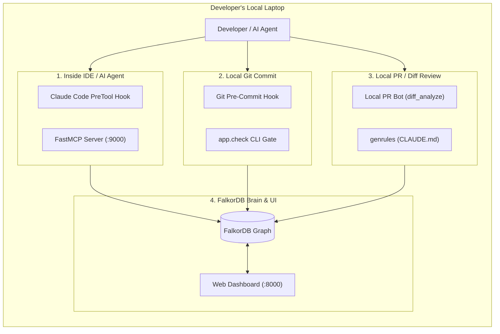

# ContextAnchor — 100% Local Developer Demo Playbook

> **Target Audience:** Hackathon Judges & Developers  
> **Environment:** 100% Local Machine (Docker / Colima / Terminal / Browser)  
> **Remote Dependencies:** None (Zero GitHub pushes, zero external CI queues)  
> **Tracks Covered:** Track 1 (Act on Connected Data) + Track 2 (Agent Memory) + Track 3 (Company Brain)  

---

## 1. Why 100% Local is Better for the Demo

- **Speed:** Instant feedback (< 100ms) with zero GitHub Actions queue or network lag.
- **Reliability:** No failure due to internet dropouts, GitHub API rate limits, or token expiration.
- **Developer Empathy:** Real developers want safety inside their local loop (**IDE $\rightarrow$ Local Git Hook $\rightarrow$ Terminal**), before bad code ever leaves their laptop.

---

## 2. The 4 Local Developer Touchpoints



---

## 3. Screen Setup for the Demo

Arrange your screen with 2 side-by-side windows:

| Left Half: Web Browser | Right Half: Terminal Window |
|---|---|
| Open at `http://localhost:8000` | Current Directory: `~/falkordb-hackathon` |
| Shows live FalkorDB Dagre graph & scenarios | Ready to run local commands & hooks |

---

## 4. Step-by-Step 4-Minute Local Demo Script

### Scene 1: The Hook & The Problem (0:00 – 0:45)
- **Speaker:**
  > *"When developers or AI coding agents work, they don't see the full blast radius of their changes. An AI agent might edit a simple discount function, not knowing it breaks the checkout flow and violates a company rule.*
  > *ContextAnchor gives the developer and their AI tools instant, local graph intelligence from FalkorDB before code even gets committed."*
- **Visual:**
  - Show the Web UI at `http://localhost:8000`.
  - Point to the FalkorDB graph showing `billing_service.py` connected to `calculate_discount`, which connects to `checkout` and live API endpoints (`GET /invoices`, `POST /checkout`).

---

### Scene 2: Interactive Graph Scenario (0:45 – 1:30)
- **Action:**
  - In the browser on the left, click **`Refactor calculate_discount`**.
- **Visual Result:**
  - Banner flashes: **`BLOCK high-impact change`**.
  - Affected nodes highlight in red/amber.
  - Right sidebar displays:
    - **AI Impact Review:** *"I must block this change due to its blast radius: affects 3 upstream functions and 2 live APIs."*
    - **Rule Alert:** `RULE-4` (Discounts can never exceed 50%).
    - **Code Owner:** Arjun Rao (9 commits, Billing Engineer).
    - **ADR:** `ADR-07` (Expand-contract for billing changes).
- **Speaker:**
  > *"Everything on this screen is computed on the fly using FalkorDB Cypher queries and native GraphBLAS betweenness centrality."*

---

### Scene 3: AI Agent Live Guard — Stopping Claude Code (1:30 – 2:30)
- **Speaker:**
  > *"Now, what happens when an autonomous AI agent like Claude Code tries to edit this risky file locally?"*
- **Action in Terminal:**
  ```bash
  # Simulate Claude Code PreToolUse hook trying to edit billing_service.py
  echo '{"tool_input": {"file_path": "billing_service.py"}}' | python3 integrations/claude-code/contextanchor_hook.py
  echo "Exit Code: $?"
  ```
- **Visual Result:**
  ```
  ContextAnchor: editing billing_service.py (BLOCK).
    - calculate_discount(): BLOCK, 3 upstream callers rules RULE-4
    - apply_tax(): REVIEW, 3 upstream callers
    - create_invoice(): REVIEW, 2 upstream callers
  Check `analyze_change` before refactoring these.
  Exit Code: 2
  ```
- **Speaker:**
  > *"Notice Exit Code 2. In Claude Code's protocol, Exit Code 2 physically aborts the tool call and feeds the error back to the model. The agent is blocked locally before writing a single bad line."*

---

### Scene 4: Local Git Pre-Commit Hook (2:30 – 3:15)
- **Speaker:**
  > *"What if a human developer tries to commit a breaking change locally in git?"*
- **Action in Terminal:**
  ```bash
  # Check calculate_discount with our terminal gate
  docker compose exec web python -m app.check calculate_discount
  echo "Exit Code: $?"
  ```
- **Visual Result:**
  - Outputs `ContextAnchor: BLOCK changing calculate_discount() [contextanchor]` with full impact explanation.
  - **`Exit Code: 1`** (Fails the pre-commit hook and stops git commit).
- **Speaker:**
  > *"Exit Code 1. The git pre-commit hook halts the commit on the developer's laptop. It never reaches GitHub."*

---

### Scene 5: Local PR Review Simulation & Multi-Language (3:15 – 4:00)
- **Speaker:**
  > *"What about Pull Request reviews? We don't need to wait for GitHub Actions in the cloud. We can generate the full PR impact review locally across any language — here's a JavaScript change in Express."*
- **Action in Terminal:**
  ```bash
  # Run PR impact review locally on an Express.js diff
  curl -s -X POST localhost:8000/api/analyze_diff -H 'Content-Type: application/json' -d '{
    "diff": "--- a/lib/application.js\n+++ b/lib/application.js\n@@ -160,2 +160,3 @@ app.handle = function handle(req, res, callback) {\n+  console.log(\"custom middleware\");\n",
    "project": "proj_express"
  }' | jq -r '.markdown'
  ```
- **Visual Result in Terminal:**
  ```markdown
  ## ContextAnchor impact review — SAFE
  _project: `proj_express`_

  Changed functions: `handle()` (SAFE)
  Blast radius — 2 upstream function(s) may break: `app()`, `mounted_app()`
  Suggested reviewers (code owners): Nitin Mohapatra
  ```
- **Speaker:**
  > *"It mapped line 160 of a JavaScript file to handle(), discovered 2 upstream callers in Express, and looked up git history to suggest Nitin Mohapatra as the reviewer."*

---

### Scene 6: Dynamic Rule Sync & Wrap-up (4:00 – 4:30)
- **Action in Terminal:**
  ```bash
  # Show auto-generated CLAUDE.md from the live graph
  docker compose exec web python -m app.genrules --project contextanchor | head -18
  ```
- **Speaker:**
  > *"Instead of flat markdown files that rot, ContextAnchor dynamically exports fresh rules directly from FalkorDB.
  > All three hackathon tracks — Graph Connected Traversal, Persistent Agent Memory, and Company Brain — run 100% locally on FalkorDB."*

---

## 5. Quick Copy-Paste Command Cheat Sheet for Demo

Keep this open during your presentation:

```bash
# 1. Health check
curl -s localhost:8000/api/health

# 2. Claude Code Agent Guard (Exit 2)
echo '{"tool_input": {"file_path": "billing_service.py"}}' | python3 integrations/claude-code/contextanchor_hook.py ; echo "EXIT: $?"

# 3. Local Git Gate (Exit 1)
docker compose exec web python -m app.check calculate_discount ; echo "EXIT: $?"

# 4. Safe check (Exit 0)
docker compose exec web python -m app.check place_order ; echo "EXIT: $?"

# 5. Local PR Diff Review (JS Express)
curl -s -X POST localhost:8000/api/analyze_diff -H 'Content-Type: application/json' -d '{"diff":"--- a/lib/application.js\n+++ b/lib/application.js\n@@ -160,2 +160,3 @@ app.handle = function handle(req, res, callback) {\n+  console.log(\"custom\");\n","project":"proj_express"}' | jq -r '.markdown'

# 6. Dynamic Rules Generator
docker compose exec web python -m app.genrules --project contextanchor | head -15
```
