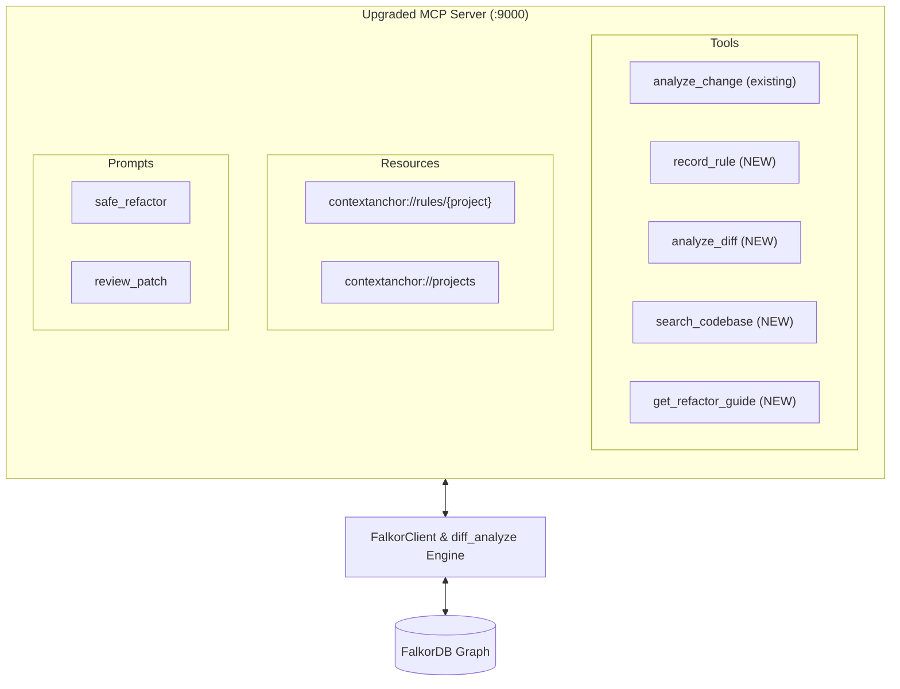

# Implementation Plan: ContextAnchor Next-Level MCP Server Upgrade

Upgrade ContextAnchor's MCP server from a basic read-only function query tool into a comprehensive, two-way AI agent development partner.

---

## 1. Goal Description

Currently, ContextAnchor's MCP server on port 9000 provides 7 read-only tools that inspect individual functions. While powerful, AI coding agents (Cursor, Claude Code, Windsurf) frequently encounter real-world friction:
1. **One-way read:** Agents cannot persist new architecture rules or learned constraints back into FalkorDB (*breaks Track 2 closed-loop agent memory*).
2. **Single-function limitation:** Agents write patches across multiple files and need diff-level blast radius analysis.
3. **Lack of discovery:** When an agent doesn't know the exact function name, it cannot search the codebase semantically.
4. **Dead-end blocks:** When an agent receives `BLOCK`, it doesn't receive actionable step-by-step refactoring guidance.
5. **No native MCP resources/prompts:** Agents have to manually guess what tools to call rather than having project rules auto-injected into their IDE context.

This upgrade implements all 5 next-level capabilities directly into ContextAnchor's MCP server and FalkorDB graph layer.

---

## 2. User Review Required

> [!IMPORTANT]
> **Zero Breaking Changes:** All 7 existing MCP tools (`analyze_change`, `blast_radius`, `team_rules`, `find_owner`, `chokepoints`, `list_functions`, `list_projects`) will remain 100% backward-compatible.
> New tools, resources, and prompts are additive.

> [!NOTE]
> **Two-Way Memory Safety:** The new `record_rule` MCP tool allows agents to add rules to the active graph. By default, rules created via MCP are assigned `source="agent"` and default to `MEDIUM` severity unless explicitly marked `HIGH`.

---

## 3. Open Questions

1. **Rule ID Generation:** Should `record_rule` allow the agent to pass a custom ID (e.g., `RULE-AUTH-02`), or should it auto-generate one (e.g., `RULE-XXXX`) if omitted?  
   *Proposed Plan:* Support optional `rule_id`; if omitted or blank, auto-generate a unique ID like `RULE-<4-char-hex>`.

---

## 4. Proposed Changes



---

### Component 1: FalkorDB Graph Layer (`app/falkor_client.py`)

#### [MODIFY] [`app/falkor_client.py`](file:///Users/purusottamkhedre/falkordb-hackathon/app/falkor_client.py)
- **Add `search(query, limit=15)` method:**
  - Queries `Function`, `File`, `Endpoint`, `TeamRule`, and `ADR` nodes using case-insensitive substring matching (`CONTAINS`).
  - Returns structured matches with node type, name, file path, FID, and relevant snippet.
- **Enhance `add_rule()`:**
  - Support matching `target_fn` by either bare `name` OR full `fid`.
  - Add `source="agent"` and optional `reason` properties.

```python
def search(self, query: str, limit: int = 15) -> list:
    """Search across functions, files, endpoints, rules, and ADRs."""
    q = query.strip().lower()
    if not q:
        return []
    results = []
    # 1. Functions
    res_fn = self.run("""MATCH (f:Function)
                         WHERE toLower(f.name) CONTAINS $q OR toLower(f.file) CONTAINS $q
                         RETURN f.name, f.file, f.fid, f.line_no LIMIT $lim""",
                      {"q": q, "lim": limit}).result_set
    for r in res_fn:
        results.append({"type": "Function", "name": r[0], "file": r[1], "fid": r[2], "line": r[3]})

    # 2. Endpoints
    res_ep = self.run("""MATCH (e:Endpoint)
                         WHERE toLower(e.route) CONTAINS $q OR toLower(e.service) CONTAINS $q
                         RETURN e.method, e.route, e.service LIMIT 5""",
                      {"q": q}).result_set
    for r in res_ep:
        results.append({"type": "Endpoint", "method": r[0], "route": r[1], "service": r[2]})

    # 3. Rules & ADRs
    res_r = self.run("""MATCH (r:TeamRule)
                        WHERE toLower(r.rule_text) CONTAINS $q OR toLower(r.id) CONTAINS $q
                        RETURN r.id, r.rule_text, r.severity LIMIT 5""",
                     {"q": q}).result_set
    for r in res_r:
        results.append({"type": "TeamRule", "id": r[0], "text": r[1], "severity": r[2]})

    res_a = self.run("""MATCH (a:ADR)
                        WHERE toLower(a.title) CONTAINS $q OR toLower(a.decision) CONTAINS $q
                        RETURN a.id, a.title, a.decision LIMIT 5""",
                     {"q": q}).result_set
    for r in res_a:
        results.append({"type": "ADR", "id": r[0], "title": r[1], "decision": r[2]})

    return results
```

---

### Component 2: MCP Server Extensions (`app/mcp_server.py`)

#### [MODIFY] [`app/mcp_server.py`](file:///Users/purusottamkhedre/falkordb-hackathon/app/mcp_server.py)

Add the following 4 new tools, 2 resources, and 2 prompts:

#### 1. Tool: `record_rule` (Two-way Memory Write-back)
```python
@mcp.tool()
def record_rule(text: str, severity: str = "MEDIUM", target_function: str = "",
                target_file: str = "", rule_id: str = "", project: str = "") -> dict:
    """Record a new architecture decision or team rule into FalkorDB graph memory.
    Use this when the user establishes a new convention or fixes a bug that shouldn't happen again.
    Args:
        text: The rule description (e.g. 'Never bypass router dispatching in handle()')
        severity: 'HIGH', 'MEDIUM', or 'LOW'
        target_function: Specific function name or FID to govern (optional)
        target_file: File path to govern (optional)
        rule_id: Optional ID (e.g. 'RULE-AUTH-10'). Auto-generated if omitted.
        project: Target codebase project (auto-detected if omitted)
    """
```

#### 2. Tool: `analyze_diff` (Patch & Multi-file Analysis)
```python
@mcp.tool()
def analyze_diff(diff: str, project: str = "") -> dict:
    """Assess the combined impact of a multi-file diff/patch before applying or committing it.
    Returns:
        verdict: 'BLOCK', 'REVIEW', or 'SAFE'
        changed_functions: functions impacted by diff hunks
        affected_functions: combined upstream blast radius
        impacted_apis: live endpoints exposed
        team_rules: governing team rules at risk
        reviewers: suggested code owners from git history
        markdown: formatted PR/patch impact summary
    """
```

#### 3. Tool: `search_codebase` (Natural Language Discovery)
```python
@mcp.tool()
def search_codebase(query: str, project: str = "") -> list:
    """Search functions, files, endpoints, rules, and ADRs across the codebase graph.
    Use this when you don't know the exact function name or need to find related architecture rules.
    """
```

#### 4. Tool: `get_refactor_guide` (Actionable Fix Blueprint)
```python
@mcp.tool()
def get_refactor_guide(function: str, project: str = "") -> dict:
    """Get a step-by-step safe refactoring playbook when a function has BLOCK or REVIEW verdict.
    Returns:
        verdict & severity: current risk assessment
        callers_to_update: upstream functions needing interface/test updates
        apis_affected: endpoints that need regression tests
        code_owner: primary git author to tag for review
        applicable_adrs: architecture guidelines to follow
        actionable_steps: ordered checklist for the AI agent to follow
    """
```

#### 5. Resources: `contextanchor://rules/{project}` & `contextanchor://projects`
```python
@mcp.resource("contextanchor://rules/{project}")
def project_rules_resource(project: str) -> str:
    """Dynamic rules document (CLAUDE.md format) auto-generated from FalkorDB."""
    c = _resolve(project)
    return genrules.build(c, fmt="claude")

@mcp.resource("contextanchor://projects")
def projects_list_resource() -> str:
    """JSON list of all ingested projects in ContextAnchor."""
    import json
    return json.dumps(client().list_projects(), indent=2)
```

#### 6. Prompts: `safe_refactor` & `review_patch`
```python
@mcp.prompt("safe_refactor")
def safe_refactor_prompt(function: str, project: str = "") -> str:
    """System prompt template for safely refactoring a function with ContextAnchor."""
    return f"""You are about to modify '{function}' in project '{project or "active"}'.
Before making edits:
1. Query `analyze_change(function='{function}')` or `get_refactor_guide(function='{function}')`.
2. Inspect the blast radius and governing team rules.
3. If the verdict is BLOCK, adhere to the applicable ADR and maintain backward compatibility."""

@mcp.prompt("review_patch")
def review_patch_prompt(diff: str, project: str = "") -> str:
    """System prompt template for reviewing a code diff against ContextAnchor graph."""
    return f"""Analyze this code diff using `analyze_diff` against ContextAnchor graph:
```diff
{diff}
```
Check for rule violations, broken live APIs, and tag the code owners."""
```

---

## 5. Verification Plan

### Automated Tests (Executed via Container)
1. **Tool Verification Suite:**
   Run an automated Python test inside the `contextanchor_mcp` container verifying all 4 new tools:
   - `search_codebase("discount")` $\rightarrow$ returns `calculate_discount` function + `RULE-4`.
   - `record_rule(...)` $\rightarrow$ saves a new rule `RULE-AGENT-TEST` into FalkorDB and verifies it governs the target.
   - `analyze_diff(...)` $\rightarrow$ analyzes a sample unified diff and returns structured blast radius + markdown.
   - `get_refactor_guide("calculate_discount")` $\rightarrow$ returns ordered steps, owner `Arjun Rao`, ADR-07, and callers.
2. **Resource & Prompt Verification:**
   - Fetch `contextanchor://rules/contextanchor` and verify markdown generation.
   - Render `safe_refactor` prompt and verify output string.
3. **End-to-End Official MCP SSE Client Test:**
   - Connect via `mcp.client.sse` to `http://localhost:9000/sse`.
   - Call `list_tools()` and verify all 11 tools appear.
   - Call `record_rule`, `search_codebase`, `analyze_diff`, and `get_refactor_guide` over SSE.

### Manual Verification
- Verify that existing UI (`http://localhost:8000`) and scenarios (1, 2, 3) remain 100% functional.
- View container logs (`docker compose logs mcp`) to ensure zero tracebacks.
